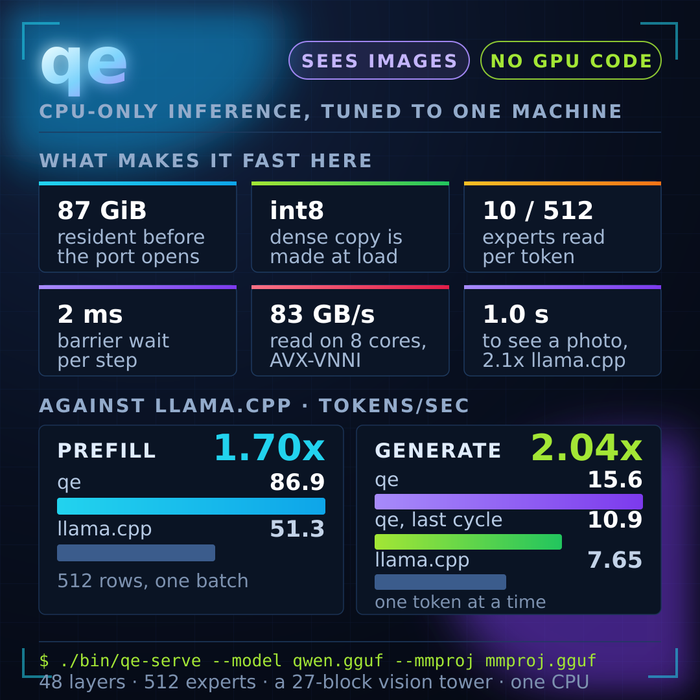

# qe



**A CPU-only inference engine for `Qwen3.8-Flash-Next`, hand-tuned to one machine:
an Intel Core Ultra 7 265 with 128 GB of DDR5 and no GPU in the picture.**

Not a fork of llama.cpp and not a wrapper around one: the GGUF reader, the
quantised kernels, the router, the attention indexer, the draft-head loop and the
HTTP server are all in this tree. It links two libraries - `libpthread` and `libm`.

```
LDFLAGS += -pthread -lm
```

There is no CUDA, Metal, Vulkan, ROCm, OpenCL or SYCL in it, and no `libggml`.
Every number below is a CPU number, taken on the box it was built on, with one
process resident at a time.

## The numbers

Measured on this host, default settings, 19 of 20 cores, one sequence:

| | qe | llama.cpp | |
|---|---|---|---|
| **Prompt ingestion**, 512-token batch | **61.3 - 63.7 tok/s** | 51.33 tok/s | **1.19 - 1.24x** |
| **Prompt ingestion**, 64-token batch | 48 - 49 tok/s | 38.8 tok/s | **1.25x** |
| **Generation**, greedy | **10.9 tok/s** (91.4 ms/token) | 7.65 tok/s (130.7 ms) | **1.43x** |
| **Generation**, greedy + draft head | **11.5 tok/s** (86.7 ms/token) | none | **1.51x** |
| **Throughput**, eight sequences in one step (`--batch 8`) | **18.0 tok/s** across a wave of eight, 10.06 each alone | none | **1.79x** |

llama.cpp is the same checkpoint and the same host: b12359 for ingestion
(`-ngl 0 -t 20 -fa on`), b12110 for generation on the same corpus. The two engines
are never resident at the same time; nothing here was measured with both of them
holding 90 GB of weights.

Instruments, so that none of the above is a claim: `make forward` (the ingestion
sweep and one A/B leg per arithmetic switch), `make head` (a step, a draft row and
a verified window, with the nextn head resident), `make batch` (B sequences through
one step, three arithmetic arms, and a row of a partly full step asserted byte for
byte against that sequence walked alone), `make lane` (the same multiplier through
the engine's request entry), `make score` (teacher-forced loss and ms/token over
1,200 real positions), `make alu` (what this machine can actually read).
[MANUAL.md](MANUAL.md) is the running log, [docs/DESIGN.md](docs/DESIGN.md)
is the kernel-by-kernel account, and `--report` prints the budget from the file's headers
alone.

## Why it is faster on *this* machine

Because it was written against this machine's measurements instead of a portable
model of a CPU.

- **The whole checkpoint is resident before the listener opens.** 87.25 GiB of
  weights are placed in RAM (or hugetlb) at startup, `mlock`ed and reused; an
  engine that cannot make the file resident prints the two numbers that decided it
  and exits. There is no lazy path, no partial load, no `mmap` fallback: a token
  never reads the device. On a 128 GB board that is not a luxury, it is the whole
  trick - and 7.7 GiB of the box is then spent on *copies* (below).
- **Kernels that run at the machine's own ceiling.** The decode step is one
  bandwidth-bound GEMV, so `make alu` measured the ceiling first: 76-79 GB/s for
  the shape a decode step has at 19 threads, 85.5 GB/s for a flat read on the eight
  performance cores. The shipped Q8_0 GEMV reaches **74-83 GB/s**. Software
  prefetch was measured as a 6-67 % regression and deleted, `vpdpbusd` without a
  matching weight layout was measured as a loss and deleted, and a
  `-mavx512f` build SIGILLs here because AVX-512 is fused off on this die, so the
  build is `-march=native` on AVX2 with AVX-VNNI.
- **Load-time requantised copies, not a faster walk of the same bytes.** A lone
  token is 66.6 % dense `Q8_0` projections and 8.9 % a `Q6_K` output head,
  and this host walks `Q6_K` at 44-46 GB/s. So at open the 496 dense matrices are
  requantised to 1.9 GiB of IQ4_NL rows and the 497 MiB head is re-stored as a
  644 MiB `Q8_0` copy - 30 % *more* bytes, 1.02x faster, because bytes are not what
  was binding. Together a step is **1.19x** faster, and `make score` prices what
  each copy costs the next-token loss so the trade is read rather than argued.
- **One int8 activation load feeding three output rows.** A chunk's activations are
  recoded to int8 once per layer and a whole expert bucket is walked against that
  panel with `vpdpbssd`; the dense projections get the same treatment from a copy
  requantised to one scale per output row, worth **1.84x** of the walk it replaces
  and 1.63x of a chunk's projection stage.
- **10 of 512 experts, walked as one pass.** Serial expert passes are 47.4 ms of an
  ingested token; one grouped pass over the bucketed experts is **27.0 ms**, and the
  seven dispatches around it are one stage graph so a short stage lends its threads
  to a long one's tail.
- **Speculation that actually pays, and only at one draft length.** The nextn head
  these checkpoints ship as a sidecar file is staged resident and runs as one more
  layer of the trunk. A draft row is 0.129 of a step; a nine-row verify window is
  4.35x a step. Acceptance only beats the window at the shortest draft, so the
  engine resolves its draft length at open from the drafter that won: 1.06x of the
  plain loop for a head at k=1, 1.05x for the n-gram drafter at k=2, and 0.99x at
  k=8 - which is why 8 is not a default anywhere in this repository, and why the
  verify window is given the same cheap read of the output head that a step gets.
- **Built for an agent's turn, not a benchmark's.** Prompt reuse across turns
  against a bounded rewind cache, q8_0 KV (21.3 KiB per token of context), an
  indexer that scores blocks so a 262,144-token window stays in line, greedy
  requests that speculate, and a pool one core short of the affinity mask because a
  spinning worker with no core of its own pays a scheduler timeslice at every one
  of the ~800 dispatches a token makes (106.2 ms at 19 threads, 125.2 ms at 20).

## Requirements

- Linux on one NUMA node, x86-64 with AVX2 + AVX-VNNI (this build was tuned on a
  Core Ultra 7 265: 20 logical CPUs - 8 performance, 12 efficient, no SMT - 30 MiB
  L3, max 5.3 GHz, 125.3 GiB addressable of the 128 GB fitted in two DDR5-5600 slots,
  both running at their rated speed).
- A C17 compiler and GNU make. No other dependency: no cmake, no curl, no
  OpenBLAS, no Python at runtime.
- **About 95 GiB of RAM free** for the checkpoint used here (87.25 GiB of weights
  plus 7.7 GiB of the load-time copies), and one GGUF you trust. If the copies do
  not fit, the engine says so at open with the bytes it wanted and the bytes it saw,
  and serves without them.
- Build it on the machine that will run it. `-march=native` is not optional here,
  and the tuning is host-specific: the numbers above are not portable, and on a
  different CPU the honest answer is `make walk` and `make alu` on your own box.

## Install and run

```sh
# 1. Build (a couple of minutes; nothing touches the model file)
make -j"$(nproc)"
make fast            # kernels only, ~25 s, no checkpoint
make test            # kernels, the speculation control loop, request parsing, chat
                     # templates, the sampler, the rewind cache, the pool, the MoE walk

# 2. What this engine thinks a token costs on this host (headers only; no weight byte)
MODEL=/path/to/Qwen3.8-Flash-Next-...-00001-of-00003.gguf ./bin/qe-serve --report

# 3. Serve it. Every weight byte is placed in RAM before the listener opens, so the
#    port stays closed until the engine can actually answer a request. After that
#    the file is never read again.
./bin/qe-serve --port 8097 \
  --model /path/to/Qwen3.8-Flash-Next-...-00001-of-00003.gguf \
  --mtp   /path/to/mtp-Qwen3.8-Flash-Next-Q4_K_M.gguf

# 4. Use it
curl -s localhost:8097/v1/chat/completions -H 'content-type: application/json' \
  -d '{"model":"qe","stream":true,"max_tokens":64,"temperature":0,
       "messages":[{"role":"user","content":"Name the three primary colours of light."}]}'
```

Only volume 1 of a multi-volume checkpoint is named; the rest are found by name.
`--mtp` is what turns on speculation for greedy requests; leave it off and the
engine falls back to an n-gram drafter (k=2, worth 1.05x of the plain loop).
`--stage huge` moves the arena into a reserved hugetlb pool and reuses it across
restarts. `--ctx N` is a memory setting as much as a token limit. `SIGTERM` closes
the listener immediately and gives the port back inside its grace period.

Routes: `/health`, `/v1/models`, `/v1/chat/completions`, `/v1/completions`, and
SSE streaming. What the engine is doing stays visible while it does it: `/health`
reports the draft head, the draft length and the turn-cache counters, and `--ui`
opens the terminal panel with the per-stage timings of the request in flight
(`make ui` shows that panel on a pty and asserts it never draws into a log).

## Pointing Crush at it

```json
{
  "$schema": "https://charm.land/crush.json",
  "options": { "request_timeout": 3600 },
  "disable_default_providers": true,
  "providers": {
    "qe": {
      "name": "qe",
      "base_url": "http://127.0.0.1:8097/v1",
      "type": "llamacpp",
      "auto_discover_models": true,
      "api_key": "qe"
    }
  }
}
```

`request_timeout` is load-bearing: it is an *idle* deadline on a stream, an unset
one is 120 seconds, and a long ingestion emits no parsed part while it runs.
`type: "llamacpp"` is the other half - its enricher reads `n_ctx` from
`/v1/models`, so the context window this process opened with becomes the window the
client plans with. `make probe-crush` drives exactly this block against a loaded
engine, including a tool call that has to come back as a tool result.

## Dials

Everything that could plausibly trade quality for time is a switch, was measured
against the thing it replaced in one load, and ships with the winning reading. The
ones worth knowing:

| variable | default | what it does |
|---|---|---|
| `QE_I4_DENSE` | `all` | read the load-time IQ4_NL copy of the dense projections; `lean` holds the 194 hyper-connection mixers and the 31 matrices at the trunk's ends at `Q8_0`, buying back two thirds of the loss for 8 ms of a step; `0` is off |
| `QE_I4_HEAD` | `q8` | walk the output head from its `Q8_0` copy (`i4`, or `stored` for the file's own `Q6_K`) |
| `QE_I4_HEAD_WIN` | `1` | let a verify window read that copy too, which is what keeps k=1 speculation ahead |
| `QE_I8_FLAT` | `1` | the flat one-scale-per-row dense copy a chunked prefill walks three rows against |
| `QE_I8_MOE`, `QE_I8_RS`, `QE_I8_PROJ` | on | the int8 activation panel in front of the experts, the row scale, and the dense projections |
| `--spec-k N` | auto | draft length; `0` turns speculation off, a head resolves to 1, the n-gram drafter to 2 |
| `--batch N` | `1` | drive N sequences through one walk of the weights: 2.15-2.20x the step they share and 1.79x a wave of eight short requests, for 0.060 nats and a per-client tok/s that gets worse (`make lane`) |
| `--walk-threads N`, `QE_WALK_THREADS` | every thread `--threads` has | threads a lone token's weight walk asks for. One kernel walking those bytes prefers 16 of 19 by 6.2 %; a step of them is 1.07x slower there, so the default is the whole pass and the knob is for a host whose bus is shaped differently (`make forward`'s width leg) |
| `QE_SMALL_PROJ_BATCH` | `1` | whether a projection under `--proj-chunk`'s 1 MiB threshold is asked of the pool once for the chunk or once for every token of it. 180 of this checkpoint's projections are under it, and the loop barriered a nineteen-thread pool 92,160 times a width-512 chunk for them, so the batch is 1.037x of an ingested token and byte for byte the same logits; `0` is the loop back (`make forward`'s small-projection leg) |
| `QE_EXP2_SIMD` | `0` | whether a gated-delta block's decay and one cell's attention weights use the eight-wide `exp2` the gates have always used rather than libm `expf`. It is 7.1-7.4x the element rate at 3.5e-06 relative, and a token asks for 114,048 to 322,992 exponentials, which at nineteen threads is 7 to 20 microseconds of an 88 ms step: measured 1.000x of ingestion and 1.00x of a step for 0.67 nats, so the dial ships off and the sixteenfold redundancy the table beside it removed ships unconditionally (`make forward`'s exponential leg) |

`make walk`, `make alu`, `make pool` and `make moe` need no checkpoint at all, so
the interesting arguments about this machine can be settled on yours.

## What this is not

- Not a GPU engine, and not a port layer for one.
- Not a throughput server, even with `--batch N`: that flag multiplies decode and
  nothing else, so two clients on 512-token prompts still cost 1.00-1.02x of the same
  two one at a time, and `make serve` still measures the wall a second client waits for.
- Not a general model runner: it runs `qwen4exp` checkpoints (48 layers, 2560 wide,
  512 routed experts with 10 active, the n-gram PLE table, hyper-connections, the
  block indexer), an OpenAI-compatible surface, and a chat template read from the
  file. Anything else it refuses at open rather than approximates.
- Not measured on your machine yet. Run `make alu`, `make walk` and `make report`
  first; the design numbers in this repository are host-specific on purpose, which
  is the only reason any of them are worth quoting.

## Layout

```
src/            20 C files: gguf reader, kernels, layers, MoE, attention,
                indexer, forward pass, sampler, drafter, spec loop, HTTP, server
include/qe.h    the whole interface, with what each function owes whom
bench/          the instruments: gemv, walk, moe, pool, alu, score, forward, head
docs/           DESIGN.md (the budget and the dead ends), ARCH.md (the shapes)
ideas.md        2,500 lines of what was measured, priced, and left off
MANUAL.md       status tables, every make target, every route, the crush notes
```
